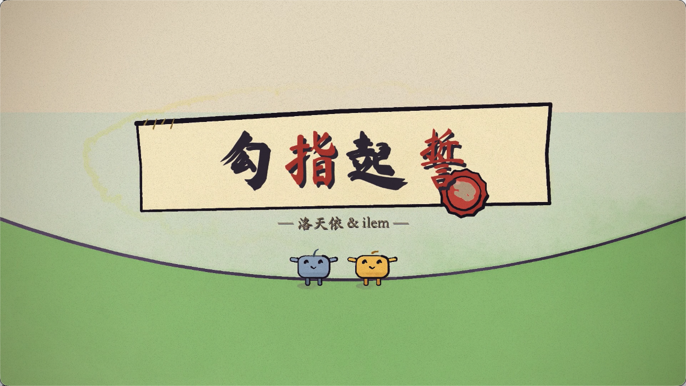

# 《勾指起誓》手绘水彩音乐 MV

> 一帧一帧"画"出来的音乐视频——用代码模拟水彩与墨线，为洛天依 & ilem 的《勾指起誓》制作的 3 分零 3 秒手绘风动画 MV。



- **歌曲**：《勾指起誓》—— 洛天依 & ilem（词曲 ilem）
- **时长**：183.5 秒（183.54s，与音轨严格对齐）
- **规格**：1920×1080 @ 24fps，共 4406 帧，H.264 + AAC
- **成片**：[`out/勾指起誓_MV_最新版.mp4`](out/勾指起誓_MV_最新版.mp4)

---

## 这是什么

整个 MV 是一场**纸上小剧场**：帷幕拉开，里面是一封长出世界的信。两位水彩小方块主角——

| 角色 | 设定 |
|---|---|
| **小凡**（"我"） | 蓝色的小家伙，起初颜色很淡，随着歌曲逐渐被点亮 |
| **小温**（"你"） | 暖金色、自带柔光的小家伙，走到哪里哪里发光 |

歌词的每一句都是一个独立小场景：信纸上写出的诗句化作鸟群、灰色街道一拍之间开花、月亮弯成笑眼、礼盒里跳出小温、三千世界只舀一瓢水……三段副歌回到同一座**山丘舞台**，完成"靠近 → 勾指戴戒 → 红线系上 → 契约盖印"的仪式升级；两段间奏分别是**出发喜剧**（收行李、地图拿反、追纸飞机、搭帐篷生火）和**四季长卷**（春樱 → 夏海 → 秋枫 → 初雪的一次横移长镜头）；结尾拉远——整个世界原来是信上的插画，火漆印章盖下，帷幕合拢。

## 技术原理

仿照 [PDoomVideo](https://github.com/JohnHeibel/PDoomVideo)（Claude Opus 5.5 制作的 "I'm Upping My P(doom)" 水彩音乐剧）的架构：

- **p5.js（WEBGL）+ p5.brush** 模拟水彩（平涂 wash / 带渗色纹理的 fill / 排线 hatch）与墨线笔刷，纸纹底 + 颗粒暗角合成；
- **每一帧是歌曲时间 t 的纯函数**（无跨帧状态、无随机数），因此可以任意乱序、断点续渲、多进程并行；
- 12fps 的手绘 "boil" 抖动让线条像逐帧手绘一样"活"；
- **puppeteer-core** 驱动无头 Chrome/Edge 逐帧渲染，**ffmpeg** 合成 MP4；
- 所有动作压在 85 BPM 的节拍网格上（`BPM=85, BEAT≈0.706s, OFF=0.02s`）。

## 项目结构

```
├── studio.html            # 画帧页面：p5 + p5.brush + 全部源码，可手动拖时间轴预览
├── render.mjs             # 渲染器：无头浏览器逐帧渲染 + ffmpeg 编码
├── qc.mjs                 # 像素探针封装（无视觉通道下的自动化质检）
├── src/
│   ├── core.js            # 引擎：常量/节拍/缓动/相机/paint 封装/文字层/纸纹/颗粒/渲染钩子
│   ├── characters.js      # 小凡 & 小温：方块水彩角色（表情集/mood morph/舞步库/手臂钩子）
│   ├── props.js           # 共享道具：山丘舞台、剧场帷幕、书桌信纸、红线、金戒、契约卷轴、火漆印、纸偶剧团、粒子、星空
│   ├── lyrics.js          # 40 句歌词时间轴（起点已按人声 onset 校正）
│   ├── timeline.js        # 章节注册、笔刷转场（wipe）、逐字上色的中文卡拉OK
│   └── ch/                # 九个章节，每章一个文件（IIFE，互相独立）
│       ├── c00_prelude.js     # 0–21s    序幕：帷幕拉开 → 信纸画出小镇 → 潜入信中 → 标题盖章
│       ├── c01_letter.js      # 21–44s   主歌一：8 句 8 幕（诗行化鸟/童话书/灰街开花/月色/烟囱礼物/开箱/三千世界/一瓢水）
│       ├── c02_hill_day.js    # 44–68s   副歌一：白日山丘（靠近/温暖/坚强/柔软/金戒/岁月/牵手/远路）
│       ├── c03_depart.js      # 68–89s   间奏一：出发喜剧（打包/地图/追逐/篝火搭帐篷）
│       ├── c04_map.js         # 89–112s  主歌二：夜色 8 幕（折纸地图/标记点/分割线/前世走马灯/烛光/万物螺旋/小星球）
│       ├── c05_hill_night.js  # 112–132s 副歌二：星夜山丘（星座/萤火虫/围巾/星河/∞星座/山脊同行）
│       ├── c06_seasons.js     # 132–158s 间奏二：四季横移长卷（春樱/夏海/秋枫/初雪，连续权重无级过渡）
│       ├── c07_hill_dawn.js   # 158–180s 终副歌：日出金橙（破晓/依偎/契约盖印/举手/大日落定格）
│       └── c08_finale.js      # 180–183.5s 尾声：拉远见信 → 火漆盖章 → 帷幕合拢
├── assets/
│   ├── song.mp3           # 歌曲
│   └── fonts/             # 霞鹜文楷、马善政毛笔字体（本地引用，离线渲染）
├── out/
│   ├── gouzhi.mp4                     # 成片
│   ├── 勾指起誓_MV_最新版.mp4         # 成片副本（最新文件名，防播放器缓存）
│   └── frames/                        # 逐帧 JPEG（断点续渲的工作目录）
├── DESIGN_PLAN.md         # 设计方案（PDoomVideo 架构分析 → 本片创意内核 → 技术适配）
├── STORYBOARD.md          # 逐句分镜表（与实现一致）
└── PDoomVideo/            # 参考项目源码副本
```

## 使用方法

需要：**Node.js**、**Chrome 或 Edge**（自动探测）、**ffmpeg**（`brew install ffmpeg`）。

```bash
npm install                # 安装 p5、p5.brush、puppeteer-core

# ── 调试 ──
open studio.html           # 浏览器里拖时间轴逐帧预览（无需渲染）
node render.mjs --sheet=21,21.5,22 --out=out/check.jpg      # contact sheet 审帧
node render.mjs --stills=57.6,170.7 --out=out/stills         # 全分辨率静帧
node render.mjs --clip=61:68 --out=out/clip.mp4              # 快速预览某一段（带音轨）
node qc.mjs 30,60,90                                         # 像素探针：内容覆盖率/卡拉OK带/主色/包围盒

# ── 成片 ──
node render.mjs --frames=0:183.59 --workers=4               # 逐帧渲染（断点续渲，只补缺失帧）
node render.mjs --encode --out=out/gouzhi.mp4                # 帧 + 歌 → MP4
```

渲染性能参考：Apple M5 上单帧约 120–360ms，4 workers 全片 4406 帧约 15 分钟。

## 无视觉通道的质检工作流

本项目在开发时模型无法直接查看图像，因此建立了一套**像素探针**质检体系（`render.mjs --probe` / `qc.mjs`）：在渲染页面内直接采样合成画布的像素，输出内容覆盖率、卡拉OK带墨量、平均色、内容包围盒等指标——用于发现空帧、黑屏、色块异常、元素错位、文字缺失等问题；配合 `letter()` 日志钩子定位文字坐标、ASCII 字符画做构图验证。所有章节均通过全时间线密集探针扫描。

## 文档

- [`DESIGN_PLAN.md`](DESIGN_PLAN.md) —— 设计方案：PDoomVideo 架构的移植分析、本片的创意内核、章节规划与技术适配清单
- [`STORYBOARD.md`](STORYBOARD.md) —— 逐句分镜表（与最终实现一致）

## 模型

- 模型使用GLM-5.3flash模型55轮对话构造生成

## 致谢

- **[PDoomVideo](https://github.com/JohnHeibel/PDoomVideo)** —— John Heibel 与 Claude Opus 5.5 的 "I'm Upping My P(doom)" 水彩音乐剧，本项目的技术架构与美术工艺来源
- **[p5.brush](https://github.com/acf505/p5.brush)** —— acf505 的水彩笔刷库
- **《勾指起誓》** —— ilem 词曲，洛天依演唱
